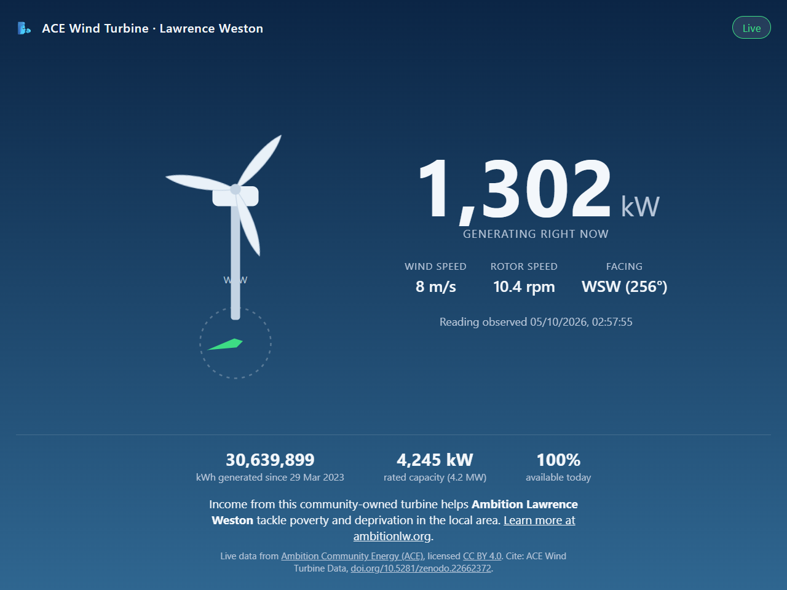
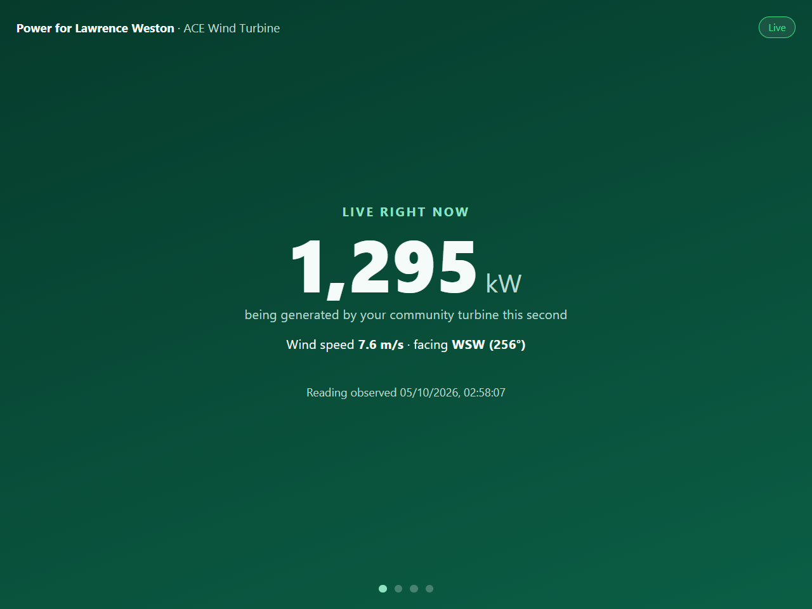
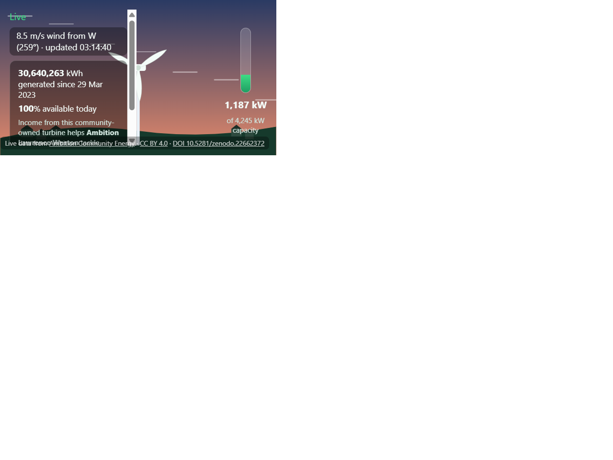
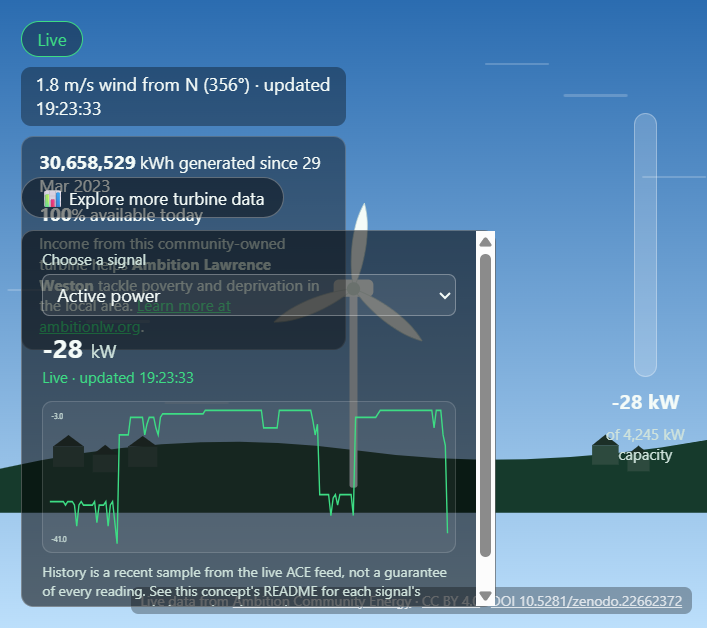

# Solutions — Challenge 5: ACE Public Communication Display

Four independent, fully working concepts for the community-centre screen,
each in its own self-contained folder. Every concept uses **live data from
the real ACE API** (`https://ace-api.duckdns.org`), is a static site with no
backend/build step, and follows the challenge's required resilience rules
(stale/offline states, capped request rate, data attribution).

| # | Concept | Folder | Story angle | Format |
|---|---|---|---|---|
| 1 | **ACE Turbine: Right Now** | [concept-1-turbine-right-now/](concept-1-turbine-right-now/) | A calm "what's happening right now" status card | Single static dashboard card |
| 2 | **Power for Lawrence Weston** | [concept-2-power-for-lawrence-weston/](concept-2-power-for-lawrence-weston/) | A slow, auto-cycling story about the turbine's community value | 4-slide looping carousel |
| 3 | **ACE Live Wind: Digital Twin** | [concept-3-live-digital-twin/](concept-3-live-digital-twin/) | Watch the turbine "work" — an animated illustration driven entirely by live data | Full-screen animated data artwork / digital twin |
| 4 | **ACE Live Wind: Digital Twin (Extended)** | [concept-4-live-digital-twin-extended/](concept-4-live-digital-twin-extended/) | Concept 3, plus an optional panel to explore 17 further live signals | Full-screen digital twin + collapsible data explorer |

Each folder has its own README with full details — endpoints used, freshness
rules, reproduction steps, licence and data credit. This page just compares
them and explains the shared setup.

## Quick preview

| Concept 1 | Concept 2 | Concept 3 | Concept 4 |
|---|---|---|---|
|  |  |  |  |

## How the four differ

- **Concept 1** is the most information-dense at a glance: power, wind,
  rotor speed, compass heading, lifetime energy, rated capacity and today's
  availability are all visible simultaneously, with no waiting. Best if the
  priority is a quick, complete snapshot for someone glancing at the screen
  for only a few seconds.
- **Concept 2** spreads the same kind of information across time instead of
  space: each slide is simpler and bigger, and the full "why this matters to
  Lawrence Weston" story only emerges if someone watches for 30–50 seconds.
  Best if the priority is storytelling and community relevance over instant
  completeness.
- **Concept 3** deliberately shows the **least** text and the **most**
  feeling: the turbine becomes a living illustration whose motion is the
  message. A small secondary info panel (lifetime energy, today's
  availability, the ALW mission sentence) adds the same community-value
  context as Concept 1, without competing with the main animation. Best if
  the priority is creativity/engagement and making the turbine feel alive,
  especially for children or a busy room where nobody has time to read.
- **Concept 4** starts from exactly the same calm animation as Concept 3 —
  untouched — then adds a collapsed-by-default "Explore more turbine data"
  panel with a dropdown covering 17 further live signals (grid voltage/
  current, power factor, blade pitch, air pressure, available-power
  estimates, daily availability trend, and more), each with its own live
  value and a small history chart. Best if the priority is Concept 3's
  ambient appeal plus genuine depth for anyone — a curious visitor, a
  classroom, an engineer — who wants to dig further, without turning the
  default view into a dense dashboard.

All four satisfy the same minimum requirements (live ACE data, screen-ready,
non-technical audience, open licence with reproduction instructions) — the
right choice depends on which judging criterion the community wants to lead
with. They could also be combined (e.g. Concept 3/4 as an ambient "idle"
state cycling into Concept 2's slides every so often).

## Shared setup, common to all four

- **No build step, no dependencies.** Each folder is plain HTML/CSS/JS. Serve
  any one of them with:

  ```powershell
  python -m http.server 8000
  ```

  then open `http://localhost:8000/concept-<n>-.../`. Serving this whole
  `solutions` folder (rather than an individual concept folder) most closely
  matches how the WeDoWind GitHub Pages gallery would serve each concept
  under its own path.

- **Live data, not a proxy.** Every concept calls `https://ace-api.duckdns.org`
  directly from the browser — there is no server-side component to deploy or
  maintain, which matches the gallery's "no API proxy" rule and keeps hosting
  as simple as any static file host (GitHub Pages, Netlify, a USB stick, etc.).

- **One shared poller per page.** Each concept copies the official
  `ace-live.mjs` helper (`createAcePoller`) from the challenge repository
  unmodified, so polling behaviour (timeouts, back-off, `Retry-After`
  handling, pause-when-hidden) is identical and already reviewed by the
  challenge organisers. Concept 4 widens its single core request to carry 18
  fields instead of 5, rather than adding a second continuous poller, so the
  page still makes at most one request per second for its live animation.

- **Honest data only.** None of the four concepts invent a "homes powered"
  or £-value conversion — per the challenge's own guidance, those would be
  invented community-impact figures ACE has not published. Instead they use
  real API values (power, energy, availability, operating hours) plus ACE/
  ALW's own public mission statement. Concept 4 goes a step further and
  excludes several wecstd weather fields found to always return a constant
  sentinel value on this turbine (see its README) rather than present them
  as if they were real sensor readings.

- **Same freshness model.** A reading older than 15 seconds is marked stale;
  if the API fails, the last good reading is retained and a clearly labelled
  offline state is shown (verified for all four by deliberately blocking the
  API during testing — see each concept's README).

## Data and licensing (applies to all four)

Live and historical turbine data: **ACE Wind Turbine Data**, Plumley,
Charlie; Garrad, Andrew; Burke, Wilf; Jonsson, Christian; Smirthwaite,
Andrew. Zenodo. DOI: [10.5281/zenodo.22662372](https://doi.org/10.5281/zenodo.22662372).
Licensed [CC BY 4.0](https://creativecommons.org/licenses/by/4.0/). Live
endpoint: `https://ace-api.duckdns.org` (accessed 4 October 2026).

Community context from the public [ACE](https://ambitioncommunityenergy.org/)
and [ALW](https://www.ambitionlw.org/) websites.

Each concept's own source code is released under the MIT License (see the
`LICENSE` file in each folder); the turbine data itself remains CC BY 4.0.

## Background materials

All four concepts were built from the research gathered in
[../materials/](../materials/) — the API reference, sample responses, and
official challenge repository guides. See
[../materials/README.md](../materials/README.md) for that reference material.

